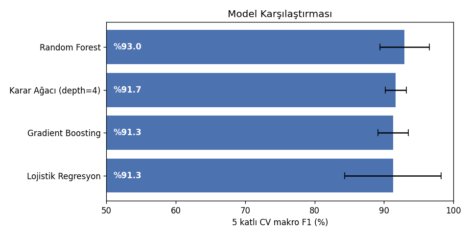
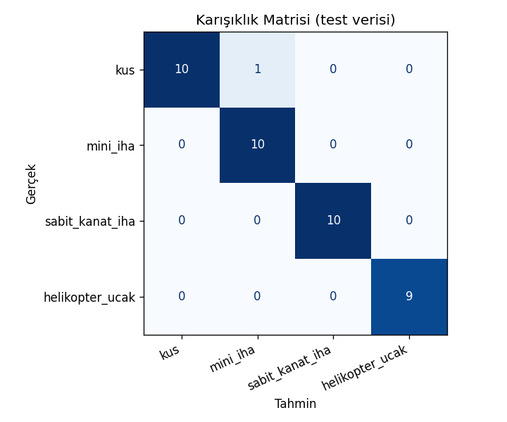
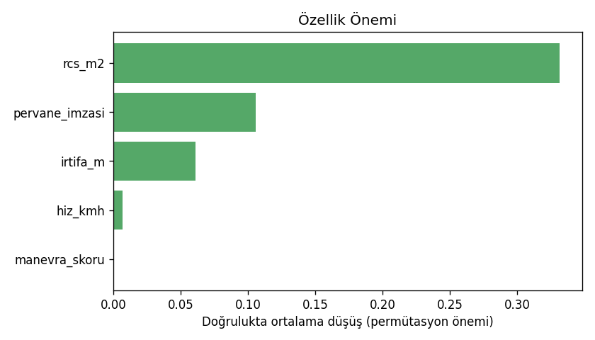

# Radar Verisiyle Hava Sahası Hedef Sınıflandırma

Radarın ölçtüğü **hız, irtifa, radar kesit alanı (RCS), manevra skoru** ve **pervane imzası** bilgilerinden, tespit edilen hava hedefinin **kuş**, **mini İHA (drone)**, **sabit kanatlı İHA** veya **helikopter/uçak** olduğunu tahmin eden uçtan uca bir makine öğrenmesi projesi.


## Problem

Küçük drone'lar boyut, hız ve irtifa bakımından kuşlara çok benzediği için radar operatörleri sık sık yanlış alarmla karşılaşır. Gerçek bir tehdidi gözden kaçırmak da her kuşa alarm vermek de pahalıdır. Bu proje, radar ölçümlerinden hedef türünü otomatik tahmin ederek operatörün yükünü azaltmayı ve tepki süresini kısaltmayı amaçlar.

## Sonuçlar

| Metrik | Değer |
|---|---|
| Seçilen model | Random Forest |
| Test doğruluğu | **%97.5** (40 örnekten 39'u doğru) |
| Makro F1 (test) | %97.6 |
| Mini İHA duyarlılığı (recall) | **%100**: test verisindeki hiçbir drone gözden kaçmadı |
| 5 katlı CV makro F1 | %93.0 |

<p align="center">
  
  
</p>
<p align="center">
  
</p>

**Öne çıkan bulgular**
- Hız ve RCS büyük hedefleri küçüklerden net biçimde ayırıyor.
- En zor ayrım **kuş ve mini İHA** arasında. İkisi de yavaş, alçak ve radarda küçük. Bu ikisini ayıran en belirleyici özellik **pervane imzası** (drone'ların %92'sinde var, kuşlarda %9).
- Tek hata, bir kuşun drone sanılması. Savunma açısından tersi (drone'u kuş sanmak) çok daha tehlikeli olacağından bu kabul edilebilir bir hata yönü.

## Proje Yapısı

```
radar/
├── data/raw/radar_hedefleri.csv     # Ham (kirli) sentetik veri seti
├── notebooks/
│   └── radar_hedef_siniflandirma.ipynb   # Keşifçi analiz + ilk prototip (Karar Ağacı)
├── src/radar_classifier/
│   ├── config.py      # Sabitler, yollar, sınıf açıklamaları
│   ├── data.py        # Veri yükleme ve temizleme
│   ├── model.py       # Aday model pipeline'ları, kaydet/yükle
│   ├── train.py       # Model karşılaştırma, değerlendirme, kayıt
│   └── predict.py     # Komut satırı tahmin aracı
├── app/streamlit_app.py   # Operatör web arayüzü
├── tests/                 # pytest birim testleri
├── reports/figures/       # Üretilen grafikler
└── .vscode/               # VS Code ayarları, çalıştırma profilleri
```

## Kurulum

```bash
git clone <repo-url>
cd radar

python -m venv .venv
# Windows
.venv\Scripts\activate
# macOS / Linux
source .venv/bin/activate

pip install -e ".[app,dev]"
```

> **VS Code:** Klasörü açın. Önerilen eklentileri yükleyin ve yorumlayıcı olarak `.venv` seçin. *Run and Debug* panelinde **Modeli eğit**, **Tahmin aracı (CLI)** ve **Streamlit uygulaması** profilleri hazırdır.

## Kullanım

```bash
# 1) Modelleri karşılaştır, en iyisini eğit ve kaydet
python -m radar_classifier.train

# 2a) Komut satırından tahmin
python -m radar_classifier.predict --hiz 45 --irtifa 150 --rcs 0.03 --manevra 2.5 --pervane 1
python -m radar_classifier.predict          # etkileşimli mod

# 2b) Web arayüzü
streamlit run app/streamlit_app.py

# Testler
pytest
```

Örnek çıktı:

```
Tespit edilen hedef büyük olasılıkla: MİNİ İHA (drone)
   Modelin güveni: %97
Öneri: DİKKAT! İzinsiz drone olabilir. Operatörü uyar ve hedefi yakından izle.
```

## Yöntem

1. **Veri temizleme:** tekrar eden satırlar, tutarsız etiketler (`KUS`, ` mini_iha`), etiketsiz satırlar ve fiziksel olarak imkânsız sensör hata kodları (negatif hız/irtifa) ayıklanır.
2. **Veri sızıntısını önleme:** Eksik değerler `SimpleImputer` ile sklearn `Pipeline` içinde doldurulur. Böylece medyan yalnızca eğitim verisinden öğrenilir. (İlk prototipte medyan tüm veriden hesaplanıyordu.)
3. **Model seçimi:** Karar Ağacı, Lojistik Regresyon, Random Forest ve Gradient Boosting, yalnızca eğitim verisinde **5 katlı tabakalı çapraz doğrulama** ile karşılaştırılır. Test verisi en sonda yalnızca bir kez kullanılır.
4. **Değerlendirme:** doğruluk, makro F1, sınıf bazında precision/recall, karışıklık matrisi ve permütasyon özellik önemi.
5. **Açıklanabilirlik:** Referans olarak derinliği 4 ile sınırlı bir karar ağacı da çizilir (`reports/figures/karar_agaci.png`). Operatörün modelin neden o kararı verdiğini görebilmesi savunma alanında önemlidir.

## Veri Seti

Gerçek radar verileri gizli olduğundan, gerçekçi fiziksel aralıklara dayanan **sentetik** bir veri seti kullanılmıştır (203 satır). Veri gerçek hayattaki gibi eksik değerler, sensör hata kodları, yazım tutarsızlıkları ve tekrar eden kayıtlar içerir.

| Sütun | Anlamı |
|---|---|
| `hiz_kmh` | Hedefin hızı (km/saat) |
| `irtifa_m` | Yerden yükseklik (m) |
| `rcs_m2` | Radar kesit alanı (m²) |
| `manevra_skoru` | Dakikadaki ani yön değişimi sayısı |
| `pervane_imzasi` | Mikro-Doppler pervane izi var mı (0/1) |
| `hedef_turu` | **Hedef:** `kus`, `mini_iha`, `sabit_kanat_iha`, `helikopter_ucak` |

## Sınırlılıklar ve Gelecek Çalışmalar

- Veri sentetik ve küçük (198 temiz satır). Gerçek radar verisinde gürültü çok daha fazla olacağı için başarı muhtemelen düşer.
- İri kuşlar (leylek, kartal) RCS bakımından drone'lara yaklaşabilir.
- Gelecek çalışmalar: kanat çırpma frekansı gibi yeni mikro-Doppler özellikleri eklemek, drone kaçırma maliyetini yansıtan sınıf ağırlıkları veya eşik ayarı yapmak, zaman serisi (iz/track) verisiyle sıralı modeller denemek.
